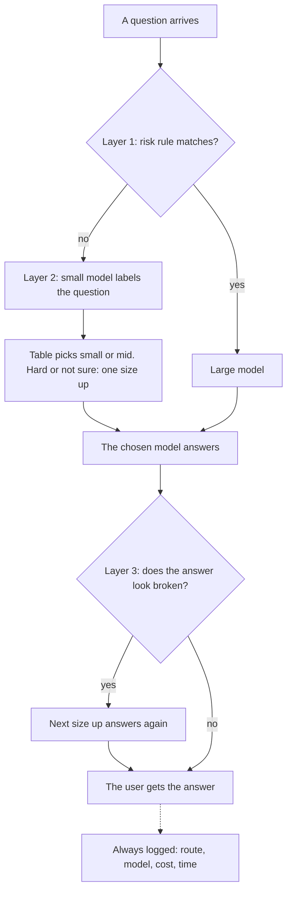

# Model Router

Companion code for the **Model Router** series on [devsdaily.com](https://devsdaily.com). It takes the HR helpdesk agent from the [Building AI Agents](https://devsdaily.com/an-agent-is-just-a-loop/) series and cuts its cost per conversation by sending each request to the right model.

Everything runs against a fake HR system (`helpdesk/hrms.py`) and a fictional handbook (`data/handbook.md`). No real company data is involved. The fake HR system starts fresh on every run. **Security: the demo tools are not a pattern to copy.** `helpdesk/tools.py` accepts any employee ID, and nothing checks that the caller may see that record. See the note under "What's where".

The helpdesk code in `helpdesk/` is a small copy of the code from the Agents series, so you only need to clone this one repo.

## What this is

An HR helpdesk agent sends every request to one model. This repo measures what that costs and builds, step by step, a router that sends each question to the cheapest model that answers it well, with a safety net and a way to prove the saving. Three tiers are compared: `gpt-5.4-nano` (small), `gpt-5.4-mini` (mid, the baseline) and `gpt-5.4` (large).

How it works, in one line per layer:

1. **Measure.** A 64-question set with a tune half and a held-out half, and a scorer that checks the answer, the tools used, the citation and refusals (Parts 1 and 2).
2. **Route.** A gateway picks a tier per user turn. First by plain rules (Part 3), then by letting `gpt-5.4-nano` classify the question (Part 4). Risky questions (pay disputes, other people's data) go to the large model first.
3. **Survive failures.** An executor adds a fallback chain, a cheap quality check that moves a turn up a tier, a write guard so a cheap tier never writes, an escalation budget and a cap on attempts (Part 5).
4. **Prove it.** Every request is logged with its route, cost and time. A replay compares before and after, and a drift check fails when quality, cost or escalation drift (Part 6).

## The articles

Read the series on devsdaily.com. Each part has a check script in `scripts/` that prints the numbers the article quotes.

| Part | Article | Code |
|---|---|---|
| 1 | [Not every prompt needs your biggest model](https://devsdaily.com/not-every-prompt-needs-your-biggest-model/) | `scripts/check_p1_baseline.py` |
| 2 | [How do you know the small model is good enough?](https://devsdaily.com/is-a-smaller-llm-good-enough/) | `evals/`, `scripts/check_p2_eval.py` |
| 3 | [Your first LLM router is just a few rules](https://devsdaily.com/rule-based-llm-router-python/) | `router/rules.py`, `router/gateway.py` |
| 4 | [When the rules run out, let a small model decide](https://devsdaily.com/llm-classifier-router/) | `router/classifier.py` |
| 5 | [LLM fallbacks: build the safety net before you need it](https://devsdaily.com/llm-fallback-to-another-provider/) | `router/resilience.py` |
| 6 | [Prove your LLM router saves money](https://devsdaily.com/measure-llm-cost-savings/) | `router/telemetry.py`, `router/drift.py`, `router/final.py` |

The agent itself comes from the [Building AI Agents](https://devsdaily.com/an-agent-is-just-a-loop/) series, mainly [Part 8](https://devsdaily.com/many-agents-or-one-good-one/) and [Part 9](https://devsdaily.com/testing-an-agent-you-cant-predict/). This series is the hands-on companion to the AI-India 2026 talk in Pune.

## The result on the held-out questions

Each setup ran the 32 held-out questions three times (96 runs). These numbers are exploratory: the held-out half was reused to choose the thresholds and the best setting. A gap under 2 cases (6 runs) is treated as noise, which is a rule of thumb and not a proof of equal quality.

| Setup | Passed | $ per conversation | Seconds |
|---|---|---|---|
| All on large (`gpt-5.4`) | 88 of 96 | $0.00438 | 2.9 |
| All on mid (`gpt-5.4-mini`), the baseline | 95 of 96 | $0.00138 | 2.4 |
| All on small (`gpt-5.4-nano`) | 88 of 96 | $0.00040 | 2.5 |
| Best single setting (mid, effort low) | 96 of 96 | $0.00138 | 5.1 |
| Rules router | 95 of 96 | $0.00135 | 2.5 |
| Classifier router, threshold 0.0 | 93 of 96 | $0.00113 | 3.3 |
| Final: classifier + cascade, threshold 0.0 | 93 of 96 | $0.00112 | 3.6 |

The final setup costs about 19 percent less than everything on mid, and the quality gap to mid is small. The three lost runs are one question, so the sample cannot show whether quality is equal. Effort low on the mid model passed every run at no extra cost, but it is about twice as slow. The saving depends on the mix of questions, and the router rows were tuned on the held-out half, so treat them as somewhat optimistic. The articles explain both. See "Limits of the evidence" below before you quote any of it.

Three notes on reading the table:

- **The small model is the cheapest row, and it is not a recommendation.** Everything on `gpt-5.4-nano` costs $0.00040 per conversation, or $0.00043 per correct answer. The reason not to use it is the kind of failure, not the count: two of its failed runs listed a colleague's leave balance (Part 2).
- **The saving is not even across task types.** Against everything on mid, cost per conversation moved about like this in the classifier router run: lookups down 68 percent, policy down 63, reasoning down 58, actions down 4, and sensitive questions up 216 percent, about 3.2 times, because the risk rule sends them to the large model (Part 6). Your saving is a function of your mix.
- **The final setup did not beat effort low on quality.** It beat it on cost and, in that run, on speed. Part of effort low's slowness comes from the API path it needs: `gpt-5.4-mini` only accepts function tools with a reasoning effort through the Responses API, so those runs use a different endpoint from the default ones (Part 2). Do not read the 5.1 seconds as a property of the setting alone.

## Setup

Python 3.12 or newer. You need an OpenAI API key to run the checks. The tests need no key. No key yet? Do the first four commands below (clone, environment, install, tests), then try the five-minute demo.

On macOS or Linux:

```bash
git clone https://github.com/iamsunny/ai-india-2026-model-router-for-cost-latency-and-quality.git && cd ai-india-2026-model-router-for-cost-latency-and-quality
python -m venv .venv && source .venv/bin/activate
pip install -r requirements.txt
pytest -q                                   # offline tests, no API key needed
cp .env.example .env                        # then add your OPENAI_API_KEY
python -m helpdesk.ingest                   # builds the handbook index once (one small embedding call)
```

On Windows (PowerShell):

```powershell
git clone https://github.com/iamsunny/ai-india-2026-model-router-for-cost-latency-and-quality.git; cd ai-india-2026-model-router-for-cost-latency-and-quality
python -m venv .venv; .venv\Scripts\Activate.ps1
pip install -r requirements.txt
pytest -q
Copy-Item .env.example .env                 # then add your OPENAI_API_KEY
python -m helpdesk.ingest
```

In Git Bash on Windows, activate with `source .venv/Scripts/activate` instead.

Run every command from the repo root, as a module (`python -m ...`), with the virtual environment active.

## Five-minute demo (simulated, no key)

```bash
python -m scripts.quickstart
```

It prints four rules routes, one canned classification at two thresholds, a reply that is not valid JSON, and one forced fallback. The routing, reply parsing, threshold and fallback code is the real code. If you have run Part 2, the rules use your own break-even table. Every model reply is scripted, so the output is labelled SIMULATED, and it shows no costs and no pass counts. It says nothing about how any model performs.

## How the pieces fit



Layer 1 is `router/rules.py`, layer 2 is `router/classifier.py`, layer 3 is the cascade in `router/resilience.py`, and every request goes through the gateway in `router/gateway.py`.

## What's where

> **Security: demo tools only.** The tools in `helpdesk/tools.py` accept any employee ID. Nothing checks that the caller may see that record, and the only guard is a line in the system prompt, which is not access control. Do not copy this pattern. A real backend takes the caller's identity from the session and enforces authorization on the server, whichever model is routed to. `scope_to` in `router/resilience.py` is a small example of refusing a call for another employee's record in the tool layer. The measured runs did not use it.

- `models.yaml`: every model the router can use, with its price. The only place a price lives.
- `router/`: the price catalog and cost code, then the router itself: `rules.py` (Part 3), `gateway.py` (the one entry point), `classifier.py` (Part 4), `resilience.py` (Part 5), `telemetry.py`, `drift.py` and `final.py` (Part 6).
- `helpdesk/`: the agent, its tools, the fake HR system and the handbook search.
- `evals/`: the question set (`cases.jsonl`, 64 cases with a task type and a tune or holdout split), sample conversations, the runner, the report code and the scoreboard.
- `scripts/`: one check script per article. Each prints the numbers the article quotes.
- `tests/`: offline tests with a scripted fake model.
- `results/`: what your runs write (raw runs, the break-even table, the scoreboard, the request log). Not committed. Each part reads what the earlier parts saved here, so run the parts in order.

## Reproduce the measurements (live inference, needs a key)

| You ran | Models | What the numbers mean |
|---|---|---|
| `scripts.quickstart`, `pytest`, any `--offline` | Scripted | Nothing. Format and wiring only. Never quote these numbers. |
| No flag, or `--quick` | Live API calls | Your own measurements. `--quick` is too small to compare setups. |

### Part 1: check your own numbers

```bash
python -m scripts.check_p1_baseline --offline   # no key, shows the output format only
python -m scripts.check_p1_baseline             # real run on the three OpenAI tiers
```

The offline run uses a scripted model, so its tokens and costs are made up. It only shows what the output looks like:

```text
offline-demo   leave-balance   in   677 out   27 cached   0 calls 2 $0.000629 0.0s
offline-demo   salary-refusal  in   315 out   69 cached   0 calls 1 $0.000547 0.0s
...
offline-demo: average $0.000941 per question over 4 questions, about $94 per 100,000 questions
```

A real run prints the same columns for `gpt-5.4-nano`, `gpt-5.4-mini` and `gpt-5.4`, plus the tools each question used and the start of the answer. Your numbers will not match the article exactly. Token counts vary a little from run to run, and a real run may show cached tokens, which cost less.

### Parts 2 to 6: run them in order

Each part reads the results of the one before it from `results/`. Most scripts have `--offline` (scripted models, no key, shows the output format only; `drift_check` needs a saved baseline, so it has no useful offline mode) and most have `--quick` (a handful of questions, to check your setup for pennies).

| Part | Command | What it does |
|---|---|---|
| 2 | `python -m scripts.check_p2_eval` | Runs the held-out questions on the three tiers and on four effort settings of the mid model. Prints pass counts, cost per correct answer, the best effort setting and the break-even table. Saves `results/break_even.json`. |
| 3 | `python -m scripts.check_p3_rules` | Routes the held-out questions with a few rules. The first half needs no model. Then it runs the router and lists the misroutes. |
| 4 | `python -m scripts.check_p4_classifier` | Lets `gpt-5.4-nano` classify each question, measures its overhead, sweeps the confidence threshold and runs the best one. Add `--brains openai:gpt-5.4-nano anthropic:claude-haiku-5-5` to compare a second brain. |
| 5 | `python -m scripts.check_p5_failures` | Scripted failures first (no key), then breaks one real model call on purpose, then runs router plus cascade. Add `--second-provider` to use Claude as the fallback. |
| 6 | `python -m scripts.check_p6_report` | Replays ten conversations before and after, prints the request log report and the final scoreboard. |
| 6 | `python -m scripts.drift_check` | Run on a schedule. Re-runs the held-out set and fails if quality, cost or escalation drifted. |

A full Part 2 run is 672 runs, one after another, so allow 30 to 60 minutes. Cost per run is printed in the table, and the runs are small (a cent or less each at list prices), but it is your key and your money, so start with `--quick`.

The numbers the articles quote come from these scripts. They are measured on the held-out half of the question set. The other half (`tune`) is for writing rules and prompts. Do not tune on the held-out half.

## Limits of the evidence

- **The held-out half was reused.** The break-even table, the classifier threshold (0.0) and the best single setting were chosen by looking at held-out results. Read the router rows as exploratory, and use a fresh set of questions before you rely on them.
- **Quality equality is not shown.** 93 of 96 against 95 of 96 is one question out of 32, failed three times. The noise rule is a rule of thumb.
- **Confidence is self-reported, not calibrated.** The classifier's confidence has not been compared with how often it is right. At threshold 0.0 it never triggers an escalation.
- **Sensitive questions go to the large model by a conservative policy, not by evidence.** In the measured runs the mid model did as well on them. The rule costs money on this mix.
- **Routing is not authorization.** The demo tools accept any employee ID. A real backend must check who may see whose data, whichever model is chosen.
- **Writes.** If a write may have run and the call then fails, the turn stops with an error instead of trying another model. A real backend should also use an idempotency key per request.

## If something fails

- **`AuthenticationError` or a 401.** The key is missing or wrong. Check `OPENAI_API_KEY` in `.env`, and run from the repo root so the file is found.
- **`The handbook index is missing`.** Run `python -m helpdesk.ingest` once. It makes one small embedding call and writes `data/handbook_index.json`.
- **`Activate.ps1 cannot be loaded because running scripts is disabled` (PowerShell).** Allow scripts for this window only with `Set-ExecutionPolicy -Scope Process -ExecutionPolicy Bypass`, then activate again.
- **`python` is not found on Windows.** Try `py -3.12 -m venv .venv` to create the environment, then `python` works inside it.
- **A 429 rate limit.** New accounts have low limits. Wait a minute and run again, or run one model at a time with `--models openai:gpt-5.4-nano`.
- **The model is not found, or you have no access to `gpt-5.4`.** Your account may not have that model yet. Run the other two with `--models`, or change the model strings in `models.yaml`.
- **The cost totals look different from the article.** Prices change. `models.yaml` was checked on 2026-11-18, so compare it with the vendor's pricing page.
- **`results/p2_runs.jsonl` is missing in Parts 3 to 6.** Run Part 2 first. The later parts compare against its runs.
- **A Claude brain or fallback fails with a missing package or key.** Run `pip install -r requirements-claude.txt` and set `ANTHROPIC_API_KEY` in `.env`. Everything else works without it.
- **`UnicodeEncodeError` on Windows when piping output.** Set `PYTHONUTF8=1` before running.

## Claude API models (optional)

`models.yaml` also prices three Claude models. To try them in the optional boxes of Parts 4 and 5, run `pip install -r requirements-claude.txt` and add `ANTHROPIC_API_KEY` to `.env`.

## Prices

Prices in `models.yaml` were read from the vendors' pricing pages on 2026-11-18. They change, so check them before you trust a cost total.
